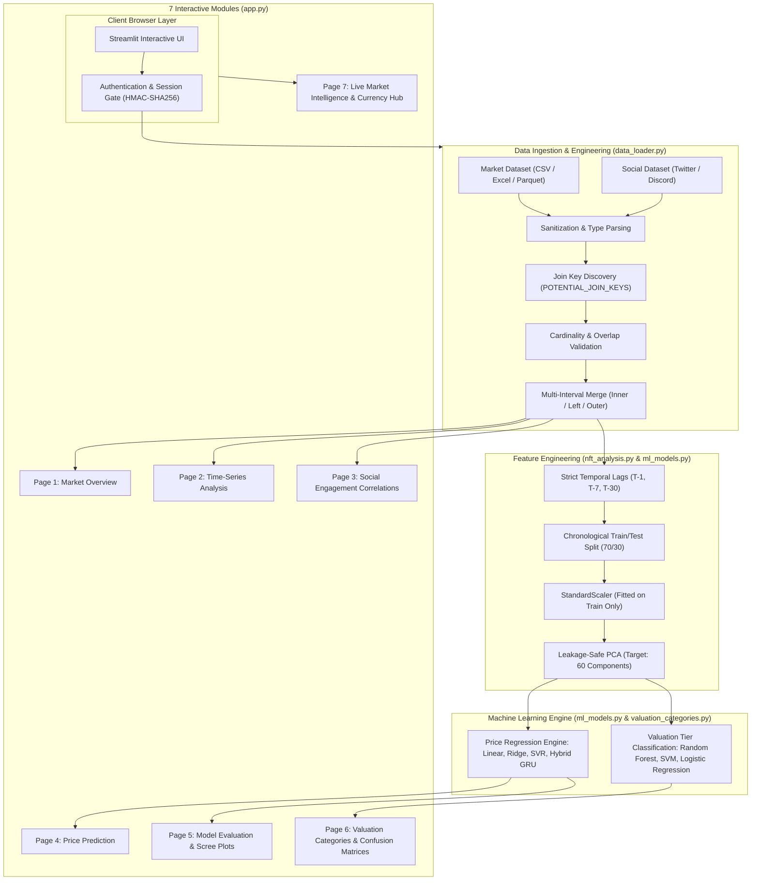

# NFT Trend Analyzer — Complete Project Architecture & Presentation Guide

**Project Title:** Analysis of Trending NFTs using Time-Series Data and Machine Learning (2026–27)
**Student Presenter:** Likitha
**Target Audience:** Project Guide, External Examiner, and Viva Voce Panel
**Document Purpose:** Complete First-Person Technical Project Walkthrough

---

## 1. Project Title & Problem Statement

> “Respected examiners, the title of my academic project is **Analysis of Trending NFTs using Time-Series Data and Machine Learning**.”

### The Core Problem
Non-Fungible Tokens (NFTs) are unique cryptographic assets verified on a blockchain. Between 2021 and 2026, the NFT market witnessed explosive trading volume, followed by extreme market volatility.

Unlike traditional financial assets (such as stocks or commodities) that have corporate balance sheets, dividend yields, or physical utility, an NFT's valuation is heavily driven by **social media sentiment, community attention, trading liquidity, and historical momentum**.

Existing market tools suffer from three fundamental problems:
1. **Isolated Analysis:** Most platforms display price charts without correlating them with social engagement metrics (such as Twitter/X likes, retweets, and Discord community size).
2. **Methodological Data Leakage:** Many academic prototypes calculate moving averages or scale data across the entire dataset prior to splitting, producing falsely optimistic predictive performance.
3. **High Feature Dimensionality:** Time-series analysis across multiple rolling windows produces dozens of collinear features (up to 127 variables), causing high variance and overfitting in classical regression models.

---

## 2. Objectives and Motivation

My project delivers an end-to-end, reproducible, research-grade analytical web platform to:
1. **Ingest and Harmonize Disparate Datasets:** Safely upload, clean, and join market sales data with social engagement data across common join keys without code execution vulnerabilities.
2. **Engineer Time-Series Features without Leakage:** Generate chronological lag features ($T-1, T-7, T-30$) and rolling window aggregates strictly using past information.
3. **Reduce Dimensionality via PCA:** Compress high-dimensional feature spaces into orthogonal principal components while fitting strictly on training data.
4. **Forecast Price Trends:** Benchmark classical regression (Linear, Ridge, Support Vector Regression) alongside deep recurrent architectures (Gated Recurrent Units).
5. **Classify Assets into Valuation Bands:** Categorize tokens into *Low*, *Mid*, *High*, and *Ultra* valuation tiers using Random Forest, Support Vector Machines, and Logistic Regression with class-balanced weighting.
6. **Provide Enterprise-Grade Access Control:** Secure user sessions using cryptographic password hashing (PBKDF2-HMAC-SHA256) and signed, tamper-evident HMAC session tokens.

---

## 3. Existing System Limitations vs. Proposed System

| Dimension | Existing Systems / Traditional Approaches | Proposed NFT Trend Analyzer |
| :--- | :--- | :--- |
| **Data Ingestion** | Assumes a single, pre-cleaned CSV; crashes on missing headers or unexpected encodings. | Supports CSV, Excel, JSON, JSONL, Parquet, and TXT with multi-encoding fallback and dual-dataset joining. |
| **Social Correlation** | Ignores social signals or treats them as isolated qualitative commentary. | Automatically detects engagement fields, cleans numeric outliers, and computes Pearson correlation matrices ($r$). |
| **Feature Engineering** | Shuffles time-series data or uses global feature scaling, leaking future information into past predictions. | Enforces strict chronological ordering; time features and rolling windows use only past values; scaling fits only on $X_{\text{train}}$. |
| **Dimensionality Reduction** | Uses all raw variables, causing high multicollinearity and slow training. | Implements leakage-safe PCA with dynamic component bounding ($\le 60$) and interactive scree plot diagnostics. |
| **Valuation Modeling** | Focuses solely on continuous regression, which is noisy during market crashes. | Combines continuous price forecasting with discrete valuation tier classification across 3 distinct algorithms (RF, SVM, Logistic Regression). |
| **Deployment & Security** | Hardcoded passwords or local scripts with no authentication or state persistence. | Production-ready Streamlit Cloud deployment with PBKDF2 salted password hashing, signed cookies, and dual-backend persistence (Supabase REST + local SQLite). |

---

## 4. End-to-End System Architecture and Data Flow



---

## 5. Technology Stack & Role of Each Technology

1. **Python 3.10+ (Language Core):**
   * Selected for its rich data science ecosystem, native support for type annotations (`from __future__ import annotations`), and cross-platform compatibility.
2. **Streamlit (Presentation & Application Framework):**
   * Acts as the unified reactive frontend and backend server. Eliminates the overhead of building separate React frontends and Flask/FastAPI backends while maintaining fast sub-second state re-renders.
3. **Pandas & NumPy (Data Processing & Mathematical Vectorization):**
   * `pandas` handles DataFrame structures, multi-encoding CSV/Excel parsing, timestamp indexing, and relational joins.
   * `numpy` executes high-speed matrix multiplications for the custom GRU forward pass and array slicing for time-series lag creation.
4. **Scikit-Learn (Machine Learning & Feature Pipelines):**
   * Supplies standard ML transformers (`StandardScaler`, `SimpleImputer`, `PCA`) and estimators (`LinearRegression`, `Ridge`, `SVR`, `RandomForestClassifier`, `SVC`, `LogisticRegression`).
5. **Plotly Express & Graph Objects (Interactive Data Visualization):**
   * Renders GPU-accelerated interactive web charts (time-series zoom, candlestick charts, scree plots, correlation heatmaps, and confusion matrices).
6. **OpenPyXL & PyArrow (Extended File Engine Support):**
   * `openpyxl` enables reading multi-sheet Excel workbooks (`.xlsx`, `.xls`).
   * `pyarrow` enables ultra-fast columnar loading of Apache Parquet binary files.
7. **Cryptography & Standard Library Security (`hashlib`, `hmac`, `secrets`):**
   * Generates cryptographically secure salt vectors, computes PBKDF2-HMAC-SHA256 password digests with 600,000 rounds, and signs session tokens.
8. **SQLite & Requests (Dual Persistence Layer):**
   * `sqlite3` provides zero-configuration local relational persistence (`.streamlit/users.db`).
   * `requests` communicates over HTTPS with the hosted Supabase PostgreSQL REST API.

---

## 6. Detailed Module Breakdown

### Module 1: `app.py` (Dashboard Presentation & Application Coordinator)
* **Purpose:** Serves as the primary entrypoint. Handles user authentication gating, sidebar navigation, dataset upload state management, and rendering of all 7 analytical modules.
* **Input:** User browser interactions, file upload streams, sidebar form parameters.
* **Processing Steps:**
  1. Anchors `_APP_ROOT` into `sys.path`.
  2. Enforces authentication via `require_authentication()`; halts unauthenticated reruns with `st.stop()`.
  3. Manages global session state keys: `dataset`, `dataset_signature`, `cleaning_stats`, `date_col`, `price_col`, `sales_col`.
  4. Renders 7 navigational pages with Plotly visualizations, diagnostics expanders, and metrics cards.
* **Output:** Rendered HTML5/CSS3 web interface and interactive Plotly components.
* **Interactions:** Imports from `api_clients`, `auth`, `data_loader`, `ml_models`, `nft_analysis`, and `valuation_categories`.

### Module 2: `data_loader.py` (Multi-Format Ingestion & Dataset Joining)
* **Purpose:** Safely ingests raw uploaded bytes across 6 file formats, normalizes column names, validates ML readiness, and performs relational joins between market and social datasets.
* **Input:** Raw binary bytes (`file_bytes`), filename string, optional sheet name, join key string, join type (`inner`, `left`, `right`, `outer`).
* **Processing Steps:**
  1. Inspects file extension; routes to `read_csv_with_fallback`, `pd.read_excel`, `read_json_data`, `read_jsonl_data`, `read_delimited_text`, or `pd.read_parquet`.
  2. Strips whitespace, normalizes empty rows, and cleans string headers.
  3. `discover_join_keys()` searches for canonical NFT fields (`collection`, `contract_address`, `sale_date`, `token_id`).
  4. `validate_join_keys()` calculates key overlap percentages, null counts, duplicate key counts, and flags many-to-many Cartesian explosion risks.
  5. `join_market_and_social_datasets()` executes `pd.merge()` with informative suffixes (`_market`, `_social`) and returns joined DataFrame with full diagnostic metrics.
* **Output:** Cleaned `pd.DataFrame` and diagnostic dictionary (`joined_rows`, `matched_records`, `overlap_unique_count`, `warnings`).
* **Interactions:** Calls `clean_dataframe`, `discover_social_columns`, `infer_column`, `parse_dates`, and `parse_numeric` from `nft_analysis.py`.

### Module 3: `nft_analysis.py` (Data Cleaning, Lag Features & Exploratory Metrics)
* **Purpose:** Core numerical and chronological feature engineering foundation.
* **Input:** Raw DataFrames, column names for date, price, and sales.
* **Processing Steps:**
  1. `clean_dataframe()`: Drops exact duplicate rows, strips leading/trailing column whitespace, replaces newline characters in headers.
  2. `parse_numeric()`: Strips currency symbols (`$`, `ETH`, `Ξ`, `WETH`), handles accounting parentheses `(12.50) -> -12.50`, removes thousands commas, converts percentages.
  3. `parse_dates()`: Converts strings or epoch timestamps to UTC-normalized datetime series.
  4. `build_time_features()`: Generates chronological lag columns ($T-1, T-7, T-30$), rolling means, rolling standard deviations, day-of-week, and day-of-year features strictly using prior observations.
  5. `compute_market_kpis()` & `compute_engagement_correlations()`: Calculates average/median prices, estimated volumes, and Pearson correlation coefficients ($r$).
* **Output:** Cleaned Series, engineered feature matrices, correlation tables.
* **Interactions:** Used by `data_loader.py`, `ml_models.py`, `valuation_categories.py`, and `app.py`.

### Module 4: `ml_models.py` (Regression Engine & Leakage-Safe PCA)
* **Purpose:** Implements continuous price forecasting models and PCA feature compression.
* **Input:** Feature DataFrame, date column, price target column, PCA target component count (default: 60).
* **Processing Steps:**
  1. Builds time features and sorts observations chronologically.
  2. Splits into Train (earlier 70%) and Test (later 30%) splits without shuffling.
  3. `fit_leakage_safe_pca()`: Fits `StandardScaler` and `PCA(n_components)` **strictly on the training matrix**. Dynamically bounds component count: $k = \min(n_{\text{samples\_train}}, n_{\text{features}}, \text{target})$. Transforms the test matrix using the trained projection matrix.
  4. Trains Linear Regression, Ridge Regression, Support Vector Regression (RBF kernel, $C=10.0, \epsilon=0.1$).
  5. If sample size $\ge 30$, trains custom `GRUHybridRegressor` (NumPy vectorized forward pass simulating a recurrent cell with reset and update gates).
  6. Evaluates Out-of-Sample metrics: Mean Absolute Error (MAE), Root Mean Squared Error (RMSE), and Coefficient of Determination ($R^2$).
* **Output:** Dictionary containing model scores, predictions, out-of-sample ground truths, and PCA diagnostic metadata (scree ratios, component counts, cumulative variance).
* **Interactions:** Consumes feature tables from `nft_analysis.py`; supplies evaluations to `app.py`.

### Module 5: `valuation_categories.py` (Valuation Tier Classification)
* **Purpose:** Discretizes continuous NFT prices into bounded valuation categories and trains comparative multi-class classifiers.
* **Input:** Continuous price series, optional custom valuation thresholds (Default: Low $< 0.5$ ETH, Mid $0.5 - 2.0$ ETH, High $2.0 - 10.0$ ETH, Ultra $\ge 10.0$ ETH).
* **Processing Steps:**
  1. `validate_valuation_bands()`: Verifies that band cutoffs are non-negative, strictly monotonically increasing, and non-overlapping.
  2. `categorize_prices()`: Converts continuous numeric ETH prices into discrete string labels (*Low*, *Mid*, *High*, *Ultra*). Unsold/zero records are labeled *Unsold / Zero*.
  3. `evaluate_valuation_classifiers()`: Constructs scikit-learn pipelines with standard scaling and balanced class weights:
     * **Random Forest:** `RandomForestClassifier(n_estimators=100, class_weight="balanced")`
     * **Support Vector Machine (SVM):** `SVC(kernel="rbf", probability=True, class_weight="balanced")`
     * **Logistic Regression:** `LogisticRegression(max_iter=1000, class_weight="balanced")`
  4. Computes Accuracy, Balanced Accuracy (to penalize class imbalance), F1-Score (macro), and 2D Confusion Matrices.
* **Output:** Comparative classification benchmark dictionary, class distributions, and confusion matrices.
* **Interactions:** Consumes features from `nft_analysis.py`; supplies classification results to Page 6 of `app.py`.

### Module 6: `auth.py` & `user_store.py` (Security & Storage Engine)
* **Purpose:** Cryptographic authentication, session management, and credential persistence.
* **Input:** User email, plain password, session cookies, database configuration.
* **Processing Steps:**
  1. `hash_password()`: Generates a cryptographically random 16-byte salt via `os.urandom(16)`; computes PBKDF2-HMAC-SHA256 with 600,000 iterations.
  2. `create_session_token()`: Serializes user payload with expiration timestamp; signs payload using HMAC-SHA256 with secret key.
  3. `verify_session_token()`: Compares cryptographic signature using `hmac.compare_digest()` to eliminate timing attack vulnerabilities. Checks token expiration (24-hour default).
  4. `user_store.py`: Employs thread locking (`threading.Lock()`) to prevent concurrent duplicate registration race conditions. If Supabase REST configuration exists, persists to cloud database; otherwise, persists to local SQLite (`.streamlit/users.db`).
* **Output:** Authentication booleans, user session objects, sanitized error messages.
* **Interactions:** Gating module for `app.py`.

### Module 7: `api_clients.py` (External Data & Live Exchange Intelligence)
* **Purpose:** Retrieves live Ethereum market spot prices and collection metrics.
* **Input:** Cryptocurrency ticker or OpenSea collection slug.
* **Processing Steps:**
  1. Fetches real-time ETH/USD spot exchange rates from CoinGecko public API with in-memory timestamp caching (5-minute TTL) to prevent rate limits.
  2. Queries OpenSea API v2 for collection floor price, total volume, and owner statistics.
  3. Gracefully handles HTTP 401/403 (missing API key) or network timeouts by falling back to conservative cached/default exchange rates ($1\text{ ETH} \approx \$3,000\text{ USD}$).
* **Output:** Float exchange rates, live collection statistics dictionaries.
* **Interactions:** Feeds currency conversion utilities on Page 6 and Page 7 of `app.py`.

---

## 7. The 7 Dashboard Modules in the UI

```
┌────────────────────────────────────────────────────────────────────────┐
│                      NFT Trend Analyzer Dashboard                      │
├────────────────────────────────────────────────────────────────────────┤
│ [Page 1] NFT Market Overview          │ Summary KPIs, asset counts,    │
│                                       │ distribution histograms        │
│ [Page 2] Time-Series Analysis         │ Daily volume, rolling averages │
│                                       │ (7D / 30D), momentum trends    │
│ [Page 3] Social Engagement Analysis   │ Scatter plots, Pearson (r),    │
│                                       │ likes vs. price correlations   │
│ [Page 4] Price Prediction             │ Chronological forecasts, SVR,  │
│                                       │ GRU Neural Network, PCA tuning │
│ [Page 5] Model Evaluation             │ MAE, RMSE, R² scores, residual │
│                                       │ scatter, PCA scree plots       │
│ [Page 6] NFT Valuation Categories     │ Multi-class RF, SVM, Logistic  │
│                                       │ Regression, confusion matrices │
│ [Page 7] Live Market Intelligence     │ CoinGecko ETH/USD rates, live  │
│                                       │ OpenSea collection telemetry   │
└────────────────────────────────────────────────────────────────────────┘
```

---

## 8. Deep-Dive on Core Machine Learning Innovations

### 8.1 Leakage-Safe Principal Component Analysis (PCA)
* **Why PCA?**
  Generating multi-interval time-series features (1-day, 7-day, 30-day lags, rolling standard deviations, transaction counts, social metrics) expands feature dimensionality up to 127 variables. Many of these features are collinear ($r > 0.85$). PCA transforms these correlated variables into an orthogonal coordinate system where each successive component accounts for the maximum possible remaining variance.
* **How is Data Leakage Prevented?**
  In naive implementations, authors perform `PCA().fit_transform(X)` on the complete dataset before splitting. This allows information from the future test period to influence the eigenvalues and eigenvectors of the components.
  In our implementation:
  $$\mu_{\text{train}}, \sigma_{\text{train}} = \text{StandardScaler.fit}(X_{\text{train}})$$
  $$W_{\text{PCA}} = \text{PCA.fit}(X_{\text{train\_scaled}})$$
  $$Z_{\text{test}} = (X_{\text{test}} - \mu_{\text{train}}) / \sigma_{\text{train}} \times W_{\text{PCA}}$$
  The transformation matrix $W_{\text{PCA}}$ never encounters any test data during fitting.

### 8.2 Three-Way Valuation Tier Classification
* **Why Three Algorithms?**
  1. **Random Forest:** Non-parametric ensemble of decision trees. Excellent at capturing non-linear threshold effects (e.g. "if likes $> 500$ and volume $> 20$, classify as Ultra"). Resilient to monotonic feature transformations.
  2. **Support Vector Machine (SVM with RBF Kernel):** Maximizes the margin separating valuation hyperplanes in infinite-dimensional Hilbert space. Highly effective for dense, continuous numerical decision boundaries.
  3. **Logistic Regression (Multinomial with L2 Regularization):** Parametric generalized linear model. Acts as the rigorous academic baseline. Evaluates whether simple linear combinations of principal components are sufficient to separate valuation tiers.
* **Handling Class Imbalance:**
  In NFT markets, "Ultra" tier assets are rare ($< 5\%$ of transactions), while "Low" tier assets predominate ($> 60\%$). Training vanilla classifiers results in models predicting only the majority class. We apply `class_weight="balanced"`, adjusting weights inversely proportional to class frequencies:
  $$w_j = \frac{N}{K \cdot n_j}$$
  Performance is evaluated using **Balanced Accuracy** and **F1-Macro** rather than raw accuracy.

---

## 9. Security, Authentication, and Cloud Resilience

1. **Password Hashing:**
   * Uses PBKDF2 (Password-Based Key Derivation Function 2) combined with HMAC-SHA256 and a random 16-byte salt per user.
   * Configured with **600,000 iterations**, matching OWASP recommended standards to prevent GPU rainbow table cracking.
2. **Session Security:**
   * Authenticated sessions are represented as base64-encoded JSON payloads accompanied by an HMAC-SHA256 signature.
   * Signature verification uses constant-time comparison `hmac.compare_digest()` to eliminate side-channel timing attacks.
3. **Dual-Backend Storage Architecture:**
   * **Hosted Cloud Mode (Supabase):** In production, connects via HTTPS REST to Supabase PostgreSQL, enforcing cloud data isolation.
   * **Local Development Mode (SQLite):** If the cloud database is paused or offline, the system safely falls back to local SQLite (`.streamlit/users.db`).
   * **Administrative Bypass:** An administrator account configured in Streamlit Cloud Secrets operates completely independently of external databases, ensuring guaranteed demonstration reliability even during cloud outages.

---

## 10. Conclusion and Academic Significance

The **NFT Trend Analyzer** bridges the gap between academic time-series research and production web engineering. By strictly adhering to zero-leakage temporal evaluation, providing comparative multi-model benchmarking (SVR, GRU, RF, SVM, Logistic Regression), incorporating leakage-safe PCA, and supporting relational dual-dataset joining, this platform provides an empirically sound, reproducible framework for studying asset dynamics in high-volatility decentralized markets.
